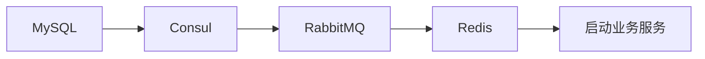

# 备份与恢复 Runbook

> **状态**：初版 · 可执行
> **适用范围**：coder-micro-services 平台全部 4 项基础设施组件
> **前置条件**：`docker compose` 已启动，`pnpm check:env` 通过
> **词法约定**：以下 `<compose>` 表示 `docker compose -f infrastructure/docker-compose.yml`

---

## 0. 一句话

- 备份：4 个命令，按需跑（手动），产物在 `./backups/` 目录
- 恢复：先停业务服务 → 恢复组件 → 启动验证 → 启动业务
- **没有自动备份**。本 runbook 是手动 SOP，自动化见 Roadmap 2.0

---

## 1. MySQL

### 1.1 数据位置

| 项目 | 值 |
|------|-----|
| 容器名 | `coder-micro-services-mysql-1` |
| Docker volume | `mysql_data` → `/var/lib/mysql` |
| 服务名（compose） | `mysql` |
| root 密码 | 从 `infrastructure/.env` 的 `MYSQL_ROOT_PASSWORD` 读取 |

### 1.2 备份

```bash
# 创建备份目录
mkdir -p ./backups

# 全量备份（全部 database）
<compose> exec mysql \
  mysqldump -u root -p"${MYSQL_ROOT_PASSWORD}" \
  --all-databases \
  --single-transaction \
  --routines \
  --triggers \
  --events \
  > ./backups/mysql-$(date +%Y%m%d_%H%M%S).sql

# 仅备份 superpowers 库（更快）
<compose> exec mysql \
  mysqldump -u root -p"${MYSQL_ROOT_PASSWORD}" \
  superpowers \
  --single-transaction \
  > ./backups/superpowers-$(date +%Y%m%d_%H%M%S).sql

# 验证：文件以 `-- Dump completed` 结尾
tail -1 ./backups/mysql-*.sql
```

**预期产物**：一个 `.sql` 文件，约 100KB-10MB（取决于数据量）。

**频率建议**：
- 开发/演示环境：不需要定期备份（数据可重新灌）
- 生产环境：每日全量 + 保留 7 天

### 1.3 恢复

```bash
# 1. 停所有读/写 MySQL 的业务服务
#    iam / notification / audit / config / file / token / prue_backend
#    和 api-gateway（依赖 Redis 但不需要停 MySQL，只停写 MySQL 的服务）
#    可以用 `docker compose stop <svc1> <svc2> ...` 或 `docker compose down`

# 2. 恢复备份
<compose> exec -T mysql \
  mysql -u root -p"${MYSQL_ROOT_PASSWORD}" \
  < ./backups/superpowers-20260729_120000.sql

# 验证
<compose> exec mysql \
  mysql -u root -p"${MYSQL_ROOT_PASSWORD}" \
  -e "SELECT COUNT(*) AS total_tables FROM information_schema.tables WHERE table_schema='superpowers';"

# 3. 重启全部服务
<compose> up -d
```

**注意**：
- 恢复前**确认备份文件对应的时间点**是最新的预期状态
- `--single-transaction` 备份不锁表，恢复期间 MySQL 不可用
- 恢复不会影响 Redis 中的 perm_epoch 缓存；如果还原到旧数据，perm_epoch 可能不同步，建议 `redis-cli FLUSHDB` 清缓存

---

## 2. Redis

### 2.1 数据位置

| 项目 | 值 |
|------|-----|
| 容器名 | `coder-micro-services-redis-1` |
| Docker volume | `redis_data` → `/data` |
| 密码 | 从 `infrastructure/.env` 的 `REDIS_PASSWORD` 读取 |

**Redis 中存储的关键数据**：
- api-gateway 限流计数（丢失不影响业务，限流会重建）
- perm_epoch 令牌失效缓存（丢失后所有之前失效的 token 重新可用——安全降级，需手动重置）

### 2.2 备份

```bash
mkdir -p ./backups

# 触发 RDB 快照
<compose> exec redis redis-cli -a "${REDIS_PASSWORD}" SAVE

# 拷贝 RDB 文件
docker cp coder-micro-services-redis-1:/data/dump.rdb \
  ./backups/redis-$(date +%Y%m%d_%H%M%S).rdb

# 验证
ls -lh ./backups/redis-*.rdb
```

**频率建议**：备份频率取决于 perm_epoch 变更频率。每次大规模权限变更后手动备份一次。

### 2.3 恢复

```bash
# 1. 停业务服务（同 MySQL 恢复第一步）
#    api-gateway 必须停（它直接读 Redis 做 perm_epoch 检查）

# 2. 停止 Redis 容器
<compose> stop redis

# 3. 替换 RDB 文件
docker cp ./backups/redis-20260729_120000.rdb \
  coder-micro-services-redis-1:/data/dump.rdb

# 重启 Redis
<compose> start redis

# 验证
sleep 3
<compose> exec redis redis-cli -a "${REDIS_PASSWORD}" PING
# 应返回 PONG

# 4. 重启全部服务
<compose> up -d
```

**注意**：
- `SAVE` 是同步阻塞操作，大数据量时可能卡几秒，生产建议 `BGSAVE`
- Redis perm_epoch 丢失意味着「所有 token 立即恢复失效前的权限」——**安全降级**，不是数据丢失

---

## 3. RabbitMQ

### 3.1 数据位置

| 项目 | 值 |
|------|-----|
| 容器名 | `coder-micro-services-rabbitmq-1` |
| Docker volume | `rabbitmq_data` → `/var/lib/rabbitmq` |
| 管理 UI | `http://localhost:15672` （guest/guest） |
| 预声明 topology | `infrastructure/config/rabbitmq/definitions.json` |

**RabbitMQ 中的数据**：
- **队列中未确认的消息**（消费者未 ack）
- **交换机/队列/绑定声明**（通过 `definitions.json` 可重建）
- **持久化消息**（队列声明 `durable=true` 的消息）
- **死信队列**（`events.dlx`）中的消息

### 3.2 备份

```bash
mkdir -p ./backups

# 方式 A（推荐）：导出 definitions（含队列、交换机、绑定 + 部分元数据）
<compose> exec rabbitmq \
  rabbitmqadmin export /tmp/definitions.json
docker cp coder-micro-services-rabbitmq-1:/tmp/definitions.json \
  ./backups/rabbitmq-defs-$(date +%Y%m%d_%H%M%S).json

# 方式 B：直接拷贝 Mnesia 数据目录（含消息体，粒度更细）
docker cp coder-micro-services-rabbitmq-1:/var/lib/rabbitmq/mnesia/ \
  ./backups/rabbitmq-mnesia-$(date +%Y%m%d_%H%M%S)/

# 验证方式 A 产物
python3 -c "import json; d=json.load(open('./backups/rabbitmq-defs-*.json')); print(f'queues: {len(d.get(\"queues\",[]))}, exchanges: {len(d.get(\"exchanges\",[]))}')"
```

**频率建议**：
- `definitions.json` 已在 git 中管理（基础设施配置），无需频繁备份
- 仅在消息丢失不可接受时才需要备份 Mnesia 目录

### 3.3 恢复

#### 方式 A：从 definitions 恢复（不保留消息体，最常用）

```bash
# 1. 停 outbox publisher 和 consumer 服务
#    iam-outbox-publisher（可能有多副本）
#    notification-service（消费 notification 队列）
#    audit-service（消费 audit 队列）
#    api-gateway（消费 perm_epoch 队列）
<compose> stop <svc1> <svc2> ...

# 2. 清空 RabbitMQ 数据
<compose> down
docker volume rm coder-micro-services_rabbitmq_data
<compose> up -d rabbitmq

# 3. 等待 RabbitMQ 就绪
sleep 15

# 4. 导入 definitions（重建 topology）
docker cp ./backups/rabbitmq-defs-20260729_120000.json \
  coder-micro-services-rabbitmq-1:/tmp/restore-defs.json
<compose> exec rabbitmq \
  rabbitmqadmin import /tmp/restore-defs.json

# 5. 验证
<compose> exec rabbitmq \
  rabbitmqctl list_queues

# 6. 重启全部服务
<compose> up -d
```

#### 方式 B：从 Mnesia 拷贝恢复（保留消息体）

```bash
# 停 RabbitMQ
<compose> stop rabbitmq

# 替换 Mnesia 目录
docker cp ./backups/rabbitmq-mnesia-20260729_120000/ \
  coder-micro-services-rabbitmq-1:/var/lib/rabbitmq/mnesia/

# 重启 RabbitMQ
<compose> start rabbitmq

# 验证
sleep 10
<compose> exec rabbitmq rabbitmqctl list_queues
```

**注意**：
- 方式 A 不保留消息体（包括死信队列）。生产环境重要消息未消费前，应考虑方式 B 或两者都做。
- outbox publisher 在 RabbitMQ 宕机期间会在 outbox 表中堆积消息，恢复后自动追上——**这是 outbox 模式的核心价值，无需手动干预**。
- `definitions.json` 已在 git 中跟踪，单纯 topology 丢失可用 `definitions.json` + 重启一步恢复，不需要本 runbook。

---

## 4. Consul

### 4.1 数据位置

| 项目 | 值 |
|------|-----|
| 容器名 | `coder-micro-services-consul-1` |
| 运行模式 | `-dev`（**纯内存，无磁盘持久化**） |
| 关键数据 | 服务注册（registrator 写）、KV store（当前仅 api-gateway health check 使用） |
| 启动重置 | 容器重启后自动恢复空状态，registrator 重注册 |

**Consul 中的关键数据**：
- 服务注册信息（registrator 自动管理，重启自动恢复）
- KV store（当前无关键配置存 Consul KV，均为本地 config.yaml）
- 会话 / 锁（无使用）

### 4.2 备份

```bash
mkdir -p ./backups

# Consul snapshot（保存服务目录 + KV + 会话）
<compose> exec consul \
  consul snapshot save /consul/data/snapshot.snap

# 拷贝到宿主机
docker cp coder-micro-services-consul-1:/consul/data/snapshot.snap \
  ./backups/consul-$(date +%Y%m%d_%H%M%S).snap

# 验证
<compose> exec consul \
  consul snapshot inspect /consul/data/snapshot.snap
```

**频率建议**：Consul 数据几乎不变（registrator 每次启动自动充满），**不需要定期备份**。仅在更改 Consul KV 后按需备份。

### 4.3 恢复

```bash
# 1. 停止 registrator（避免恢复过程中被 registrator 覆盖）
<compose> stop registrator

# 2. 恢复 snapshot
docker cp ./backups/consul-20260729_120000.snap \
  coder-micro-services-consul-1:/consul/data/restore.snap
<compose> exec consul \
  consul snapshot restore /consul/data/restore.snap

# 3. 验证
<compose> exec consul \
  consul members

# 4. 重启 registrator 和其他服务
<compose> start registrator
sleep 5
<compose> up -d
```

**注意**：
- Consul `-dev` 模式下 snapshot 无需对应 ACL token
- 多数场景下 Consul 不需要恢复——registrator 重启后会重新注册所有服务。恢复 snapshot 仅在需要保留 KV store 特殊配置时使用。

---

## 5. 一键备份脚本（参考）

以下脚本可 cron（但当前不提供自动化），手动跑一次 = 一次全量快照：

```bash
#!/bin/bash
# backup-all.sh — 全量备份 4 组件到 ./backups/ 目录
set -euo pipefail
BACKUP_DIR="./backups/$(date +%Y%m%d_%H%M%S)"
mkdir -p "$BACKUP_DIR"

echo "=== MySQL ==="
<compose> exec mysql mysqldump -u root -p"${MYSQL_ROOT_PASSWORD}" \
  --all-databases --single-transaction > "$BACKUP_DIR/mysql.sql"

echo "=== Redis ==="
<compose> exec redis redis-cli -a "${REDIS_PASSWORD}" SAVE
docker cp coder-micro-services-redis-1:/data/dump.rdb "$BACKUP_DIR/redis.rdb"

echo "=== RabbitMQ (definitions) ==="
<compose> exec rabbitmq rabbitmqadmin export /tmp/defs.json
docker cp coder-micro-services-rabbitmq-1:/tmp/defs.json "$BACKUP_DIR/rabbitmq-defs.json"

echo "=== Consul ==="
<compose> exec consul consul snapshot save /consul/data/snap.snap
docker cp coder-micro-services-consul-1:/consul/data/snap.snap "$BACKUP_DIR/consul.snap"

echo "=== Done: $BACKUP_DIR ==="
ls -lh "$BACKUP_DIR/"
```

---

## 6. 恢复顺序

需要同时恢复多个组件时，按以下顺序：



1. **MySQL**（最慢，先做）
2. **Consul**（服务发现基础）
3. **RabbitMQ**（消息中间件）
4. **Redis**（缓存，最后做——重启业务服务前一刻）
5. 启动业务服务

---

## 7. 备份存储建议

| 组件 | 备份文件 | 建议保留 | 建议异地 |
|------|---------|---------|---------|
| MySQL | `.sql` | 7 天 | ✅ |
| Redis | `.rdb` | 按需 | 按需 |
| RabbitMQ | `.json` + `.mnesia/` | 3 天 | 按需 |
| Consul | `.snap` | 不保留（registrator 自动重建） | 不需要 |

> **1.0 前最低要求**：MySQL 每日 cron 全量备份 + 至少保 3 天。其余组件徒手操作即可恢复。
