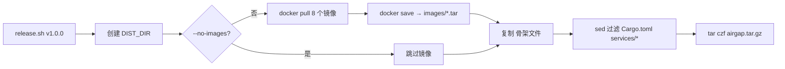

# release/dist-template 离线分发包设计（追认）

> 日期：2026-07-23
> 状态：追认（7 月分发包已上线，本 spec 补文档）
> 关联：[ADR-004 Release Engineering](../../../docs-site/decisions/ADR-004-release-engineering-architecture.md)
> 范围：`release/dist-template/` + `release/dist-template/scripts/release.sh` + `release/dist-template/bin/*` + `release/dist-template/Makefile`
> 风险：低（追认已上线代码 + 补文档）

---

## 1. 现状

### 1.1 已交付能力

7 月完成"平台从『仅本地跑』→『可离线交付给客户私有化部署』"链路：

```bash
# 有网环境打包
bash release/dist-template/scripts/release.sh v1.0.0
# → release/coder-micro-services-v1.0.0-airgap.tar.gz  (10-15 GB)

# 客户环境部署
tar xzf coder-micro-services-v1.0.0-airgap.tar.gz
cd coder-micro-services-v1.0.0
bash bin/load-images.sh    # 离线加载 8 个平台镜像
make secrets               # 生成 JWT 密钥 + 随机密码
make up                    # docker compose 起全栈
make verify                # 冒烟测试
```

### 1.2 分发包结构（v2 骨架模式）

```
coder-micro-services-<version>/
├── bin/                    # 一键运维（8 个 shell 脚本）
│   ├── generate-secrets.sh  # JWT + 密码
│   ├── load-images.sh       # 离线 tar → docker load
│   ├── start.sh / stop.sh
│   ├── status.sh / logs.sh
│   ├── verify.sh            # 冒烟测试
│   ├── seed-demo.sh         # demo 数据
│   ├── reset-data.sh
│   └── upgrade.sh
├── compose/                # docker-compose 模块化
│   ├── infra.yml           # MySQL / Redis / Consul / RabbitMQ / Registrator
│   ├── services.yml        # 8 平台服务（image: registry/svc:tag）+ frontend
│   └── observability.yml   # Prometheus / Grafana / Jaeger / OTel
├── config/                 # 运行时配置
├── init-mysql/             # MySQL 初始化 SQL
├── frontend/               # 前端源码 + pnpm-lock.yaml（不含 node_modules）
├── images/                 # 离线 Docker tar + manifest.json
├── secrets/                # 生成产物（runtime，gitignored）
├── services/               # 空 —— 用户在此建业务微服务
├── skills/                 # 6 个 AI skill（3 Rust + 3 Java）
├── contracts/              # 契约层
├── scripts/                # CI 门禁脚本
├── Cargo.toml              # workspace 根（sed 过滤后：libs 保留，services/* 剔除）
├── pnpm-workspace.yaml
├── package.json
├── AGENTS.md
├── docker-compose.yml      # 主入口（include 3 个 yml）
├── Makefile                # 命令统一入口
└── .env.example
```

### 1.3 平台镜像清单

`release.sh` 硬编码 8 个镜像（`IMAGES=(...)`, line 61）：
- api-gateway / iam-service / token-service / notification-service
- audit-service / config-service / file-service / prue-admin-backend

Registry 前缀由 `REGISTRY` 环境变量控制，默认 `zhcoder-docker-registry.com:8000`。

### 1.4 为什么用 v2 骨架而非源码全打包

**放弃"服务源码全打包"路径的理由**：
- 平台镜像 10-15 GB 已经不小；再叠源码翻倍
- 客户拿到源码也不会改（客户只关心接入自己的业务微服务）
- 源码变更频繁，v2 骨架结构更稳定，易于版本升级

---

## 2. 设计

### 2.1 打包流程



### 2.2 客户部署流程

```bash
# Step 1: 载入镜像（离线）
bash bin/load-images.sh
# 依次 docker load < images/*.tar，附带 manifest.json 校验

# Step 2: 密钥/密码初始化（一次性）
make secrets
# → 生成 secrets/jwt-*.pem + .env（随机密码）

# Step 3: 起全栈
make up
# → docker compose -f docker-compose.yml up -d
# 依次起 infra → services → observability

# Step 4: 冒烟测试
make verify
# → 走 api-gateway 打 health / iam / token 端点

# Step 5（可选）：demo 数据
make seed-demo
```

### 2.3 骨架 vs 完整包切换

`--no-images` / `EXPORT_IMAGES=0`：
- 跳过 `docker pull` + `docker save`
- 输出仅骨架的 airgap 包（MB 级）
- 适用：客户已有镜像仓库拉取权限，无需离线 tar

### 2.4 platform 镜像扩展点：AI Skills

用户在客户环境 `services/` 为空。通过 6 个 skill 自建业务微服务：
- Rust: `coder-new-service` / `coder-add-route` / `coder-migrate-db`
- Java: `coder-new-java-service` / `coder-add-java-route` / `coder-migrate-java-db`

skill 生成的新服务：
- 追加 workspace member（Cargo.toml / pom.xml）
- 追加 `compose/services.yml` 服务定义
- 追加 `config/api-gateway/routes/*.router.toml` 路由
- 自动通过 CI 门禁

---

## 3. 测试计划

- [x] 已验证：`bash release/dist-template/scripts/release.sh v1.0.0` 输出 airgap.tar.gz
- [x] 已验证：`--no-images` 骨架模式跳过镜像导出
- [x] 已验证：客户环境 `bin/load-images.sh` + `make up` + `make verify` 全流程通
- [ ] 待做：多架构镜像（linux/arm64）打包验证
- [ ] 待做：airgap 包 checksum 校验（`sha256sum`）
- [ ] 待做：manifest.json 完整性校验（镜像数量 == 清单条数）

---

## 4. 回滚方案

### 4.1 回滚触发条件

- 客户环境 `make up` 失败（image pull / port conflict / 密钥错误）
- `make verify` 冒烟失败
- 业务侧发现旧版本比新版本稳定

### 4.2 回滚步骤

1. `make down` 停当前版本（数据卷保留，`docker compose down` 不加 `-v`）
2. 展开旧版本 tarball 到新目录
3. 在旧目录 `make up`（会读同一 MySQL / Redis 数据）
4. **注意**：跨版本回滚需检查 migration 是否单向不可逆（`prue_backend` 例外，其他服务 forward-only）

### 4.3 回滚耗时估计

- 分钟级（`make down` + `make up` 各 30-60s）
- **数据无损失**（volume 保留）
- 除非 migration 单向不可逆（当前均为 forward-only；开发期无生产数据无需保留）

### 4.4 不能回滚的情况

- 加密算法 / JWT 签名 key 变更：需前置手动 key rotation
- Schema 破坏性变更（新版本 drop 老字段）：需前置数据迁移预演

---

## 5. 已知限制 / 后续工作

- `release/dist-template/release/coder-micro-services-1.0.0/` 是 v1.0.0 完整快照 —— 未来会积累多版本，需清理策略（例如 CI 只保留最近 3 个版本）
- 无 airgap 包完整性校验（GPG 签名 / SHA256）
- 平台镜像清单硬编码在 `release.sh` line 61 —— 新增服务时需手动同步
- 多架构（arm64）打包未在 release.sh 默认走通

---

## 6. 关联

- **ADR-004** Release Engineering Architecture
- **相关 spec**: `2026-07-23-setup-wizard-design.md` / `2026-07-23-sdk-publishing-design.md`
- **相关 skill**: `.agents/skills/coder-new-service/` / `coder-new-java-service/`
