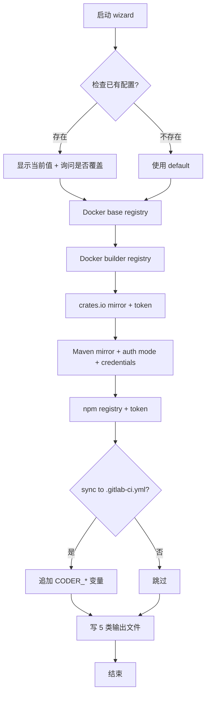

# setup-wizard 交互式引导设计（追认）

> 日期：2026-07-23
> 状态：追认（7 月 setup-wizard 已上线，本 spec 补文档）
> 关联：[ADR-004 Release Engineering](../../../docs-site/decisions/ADR-004-release-engineering-architecture.md)
> 范围：`scripts/setup-wizard.js`（891 行）+ 输出的 5 类配置文件
> 风险：低（追认已上线代码 + 补文档）

---

## 1. 现状

### 1.1 已交付能力

`scripts/setup-wizard.js` 是"首次 clone 仓库后跑一次"的交互式配置引导，用于**零信任本地化配置**——本人 / 团队成员 / CI 各自跑一次，配出符合自己网络/凭证环境的运行时配置。

```bash
# 交互式（默认）
node scripts/setup-wizard.js

# 非交互式（CI / 脚本化）
node scripts/setup-wizard.js --non-interactive --defaults

# 仅显示当前配置
node scripts/setup-wizard.js --show

# 干跑（不写文件）
node scripts/setup-wizard.js --dry-run
```

### 1.2 配置维度（5 类）

| 维度 | 官方源 | 私有替代 | 输出文件 |
|------|--------|----------|----------|
| Docker 基础镜像 | Docker Hub | Nexus / Harbor | `infrastructure/.docker-registry.json` |
| Docker builder 镜像 | 官方 | 内网 registry（默认 `zhcoder-docker-registry.com:8000`）| 同上 |
| Cargo crates | crates.io | rsproxy / 私有 kellnr | `.cargo/config.toml` + `.cargo/credentials.toml` |
| Maven | Maven Central | Nexus / Reposilite | `.mvn/settings.xml` + `.mvn/maven.config` |
| npm | npmjs | 镜像 registry | `.npmrc`（项目根）|

**所有输出文件均 gitignored**，个人 / 团队 / CI 环境隔离。

### 1.3 Maven 认证三档

| 模式 | 说明 |
|------|------|
| `none` | 不写 `<servers>`（公网只读镜像）|
| `token` | 公网项目 token，username 固定 `token`（例：GitHub Packages）|
| `userpass` | 私有部署 username + password（Reposilite / Nexus）|

### 1.4 GitLab CI 同步

wizard 可选同步部分选项到 `.gitlab-ci.yml`（`CODER_*` 变量写入 `variables:` 段），使 CI 环境自动继承 registry 配置。

### 1.5 为什么零信任本地化

**放弃"仓库带默认 registry 配置"的理由**：
- 团队成员在不同网络（公司内网 / 家庭 / 出差）
- CI 与开发机 registry 不同
- 私有 kellnr / Reposilite token 是**个人凭证**，不能进 git
- 客户离线环境无法访问公网 registry

---

## 2. 设计

### 2.1 交互流程



### 2.2 输出文件详解

#### `.cargo/config.toml`

被**覆盖式重写**（保留 kellnr 私有 registry 与 `git-fetch-with-cli`）。示例：

```toml
[source.crates-io]
replace-with = "coder-mirror"

[source.coder-mirror]
registry = "sparse+https://rsproxy.cn/index/"

[source.kellnr]
registry = "sparse+https://kellnr.example.com:8000/api/v1/crates/"

[net]
git-fetch-with-cli = true
```

#### `.cargo/credentials.toml`

仅当 `crateToken` 非空时生成：

```toml
[registry.kellnr]
token = "xxx"
```

#### `.mvn/settings.xml`

`<mirrors>` 段替换 central，`<servers>` 段同时覆盖 mirror + 发布仓库 id。

#### `.mvn/maven.config`

单行 `-s.mvn/settings.xml`，让 `mvn` 命令自动加载。

#### `.npmrc`（项目根）

```
registry=https://npm.example.com/
//npm.example.com/:_authToken=xxx
```

`_authToken` 仅当 `npmToken` 非空时写入。

### 2.3 Non-interactive 模式

- `--non-interactive` + `--defaults`：全走默认值（走 CI 时用）
- 无 tty 检测（避免脚本挂死）
- 输出与交互模式一致

### 2.4 与 gitlab-ci.yml 的同步

wizard 会读 `.gitlab-ci.yml` 的 `variables:` 段，追加/更新如下变量：

```yaml
variables:
  CODER_BASE_REGISTRY: "..."
  CODER_BUILDER_REGISTRY: "..."
  CODER_CRATES_MIRROR: "..."
  # ...
```

CI 环境的 build/deploy 阶段读这些变量，走同样的镜像 / 依赖源。

---

## 3. 测试计划

- [x] 已验证：`--show` 输出当前配置，无交互报错
- [x] 已验证：`--non-interactive --defaults` 全跑默认值，退出码 0
- [x] 已验证：TTY 环境手动跑一遍所有 prompt
- [x] 已验证：Maven 三种认证模式全跑通
- [x] 已验证：Ctrl+C 中断退出码 130
- [x] 已验证：`NO_COLOR=1` 无颜色输出
- [ ] 待做：多次跑 wizard 不同选项，验证覆盖式重写不丢自定义 kellnr 段
- [ ] 待做：Windows PowerShell 兼容验证

---

## 4. 回滚方案

### 4.1 回滚触发条件

- 依赖拉取失败（镜像源不可达 / token 失效 / 认证被拒）
- Docker pull 走了错误 registry
- Maven 发布到错误目标仓库

### 4.2 回滚步骤

1. **恢复输出文件到 wizard 前状态**：
   ```bash
   rm .cargo/config.toml .cargo/credentials.toml
   rm .mvn/settings.xml .mvn/maven.config
   rm .npmrc
   rm infrastructure/.docker-registry.json
   ```
2. 重跑 `node scripts/setup-wizard.js` 输入正确值
3. 或 `--defaults` 走默认值（公网源）

### 4.3 回滚耗时估计

- 秒级（删文件 + 重跑 wizard）
- **无数据损失**（wizard 只写配置文件，不改数据）

### 4.4 不能回滚的情况

- 如果 wizard 已 `--sync-gitlab-ci` 写入 `.gitlab-ci.yml` 并 push 到远程 → 需 revert commit
- 如果 wizard 期间已用错误配置 `mvn deploy` 到错误仓库 → 需在目标仓库手动清理

---

## 5. 已知限制 / 后续工作

- **`.cargo/config.toml` 覆盖式重写**：用户手改的其他 `[source.xxx]` 段会丢，需先手动备份
- **交互复杂度高**：5 类配置 + 每类的 mirror/token/auth mode，setup-wizard 891 行
- **Ctrl+C 泄漏保护**：`onCancel` 已注入统一退出码 130
- **CI 变量与 wizard 交互冲突**：wizard 不知道 CI 环境已注入哪些 CODER_* 变量 → 可能覆盖
- **Maven `userpass` 认证明文写盘**：`.mvn/settings.xml` 中 password 明文，仅本地 gitignored，风险有限

---

## 6. 关联

- **ADR-004** Release Engineering Architecture
- **相关 spec**: `2026-07-22-scripts-cli-ux-design.md`（wizard 用了 chalk/ora/prompts）
- **相关 spec**: `2026-07-23-release-dist-template-design.md` / `2026-07-23-sdk-publishing-design.md`
